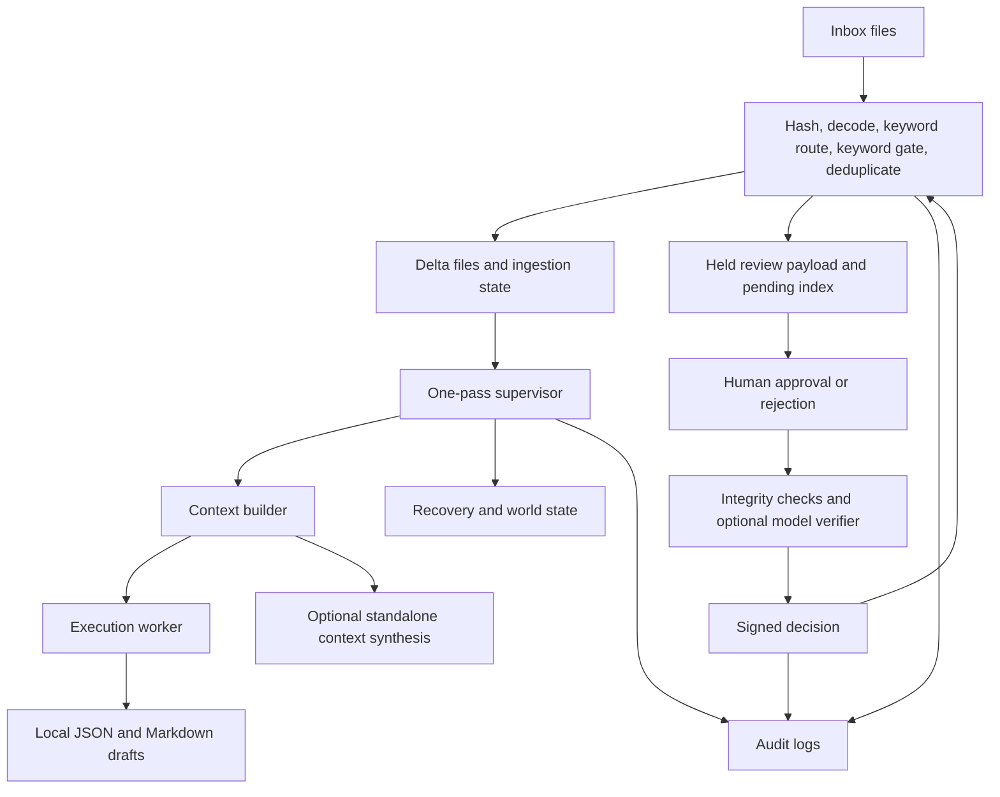
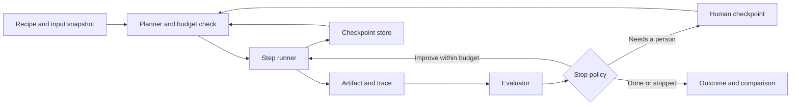

# Looping Box project review and development proposals

Review date: October 13, 2026. Reviewed implementation: `e2372db49a8f59323d9b8d96454c2346f852af22` on `main`, package version `0.1.0`.

Looping Box has a useful, understandable foundation: a small Python package that ingests files, holds recognized action language for a recorded human decision, and produces local drafts. It is not yet a general AI loop experimentation tool. Several reliability defects undermine its stronger current claims, and the existing 0.2.0 specification already describes much of the necessary repair work.

The recommended destination is **a local workbench for learning, running, comparing, and inspecting bounded AI loops**. Its central question should be: “Did another iteration improve this result enough to justify its cost, delay, and human effort?” Preserve the inspectable files, offline operation, and deliberate human review that distinguish the current project. Build the comparison and learning experience around a corrected core.

This review contains 56 numbered correction and enhancement proposals: C01–C24 for implementation and verification, D01–D10 for documentation and content, and E01–E22 for the expanded workbench. These are review proposals, not implementation authorization or completion claims. Priorities reflect this project's present draft-only scope.

## Current position and Git evidence

| Area | Verified position | Implication |
|---|---|---|
| Working tree at review start | No staged, unstaged, or untracked changes | There was no pending patch to approve or reject. Findings concern committed code. |
| Branch | `main`, HEAD `e2372db`; zero ahead/behind the locally recorded `origin/main` | No remote fetch was performed, so this does not establish the server's current state. |
| Local tags | None returned by `git tag --list` | A package version string does not establish a tagged or published release. |
| Implementation size | 14 Python modules, 3,328 source lines | Still small enough for targeted repair; a wholesale rewrite is unnecessary. |
| Tests | 107 `test_*` methods across 11 modules, counted from the AST | Substantial regression investment, but method counts do not establish coverage or current pass status. |
| CI configuration | Ubuntu Python 3.9/3.12/3.14, Ruff, install-and-run packaging smoke | CI is configured; live CI outcomes were not checked. macOS acceptance is not in this workflow. |
| Companion specification | [0.2.0 specification](/Users/ryanjohnson/Projects/looping-box-spec/spec.md), revision 2.0, October 3, 2026; target 0.2.0 | Same recorded source baseline as this review. Twelve tasks and 31 acceptance scenarios remain marked unimplemented/unverified in the handoff. |
| GitNexus | Metadata identifies `e13f7ab`, three commits behind HEAD | All 14 current Python-module hashes match the indexed hashes. The graph helped locate flows, but commit freshness is still stale and graph completeness is not assumed. |
| Runtime verification here | 23 bounded diagnostic scenarios on Python 3.14.7, using temporary workspaces, a fake signing key, and blocked/stubbed model transport | Several defects were reproduced. This is not a full-suite, platform-matrix, provider, or human-accessibility acceptance result. |
| Review changes | This dated review document only | Application code, configuration, existing tests, and existing roadmap/specification were not changed. |

The most recent three commits were also reviewed in their current integrated form:

- `c0fa6cb`, report command: the implementation has report-text-dependent exit status, weak rendering of arbitrary notes, and only a narrow report regression test. See C17.
- `7127547`, nine demos and runner: the examples make the pipeline tangible, but inherit model settings, reuse predictable temporary directories, and sometimes print outcomes without asserting them. See C19 and C24.
- `e2372db`, use cases and documentation: useful breadth, but several “today” capabilities and the sales opening overstate what the pipeline does. See D01–D05.

The wrapper-based GitNexus invocation attempted an unavailable registry lookup. The already-installed CLI was then used successfully for query, context, and impact analysis. No index rebuild was run.

## How the project works

The main command is `looping-box run`. It calls ingestion and then one supervisor pass. The source-checkout wrapper `startday.sh` follows the same general sequence, with argument differences described in C18.



Important details:

1. Ingestion scans supported `.md`, `.txt`, and `.json` files recursively. It skips input symlinks and hidden paths, hashes content, decodes it, matches configured route/gate terms, and creates a bounded excerpt. The default excerpt is 500 characters, with whitespace flattened.
2. Routing currently attaches labels such as `documentation`, `task_backlog`, and `context_package`. Those labels do not select separate specialist workers or move files into folders.
3. The gate matches normalized keywords against input text before deduplication. A held item gets a stable review identity based on path, content hash, and reasons. It remains in the inbox.
4. Approvals and rejections are HMAC-signed with a user key. Approval means permission to enter local drafting; there is no executor that performs the action described by the input.
5. The supervisor has two hard-coded workers and recognized dependency edges. The configuration can enable/disable those edges, but it does not implement a general graph engine or arbitrary plugins.
6. The context builder reads queued deltas into eligible items and held inputs. It can request a model-generated synthesis, which is saved for reading. The execution worker currently does not use that synthesis.
7. The execution worker copies excerpts when offline. With its model enabled, it asks for short working notes. Multiple items share one model request; one item uses an unconstrained text response.
8. The verifier runs during approval of held input. It does not grade every generated draft, and its feedback does not drive an automatic revision loop. A configured verifier can prevent approval by returning a failure.
9. Artifacts and state are ordinary local files. Prior nonempty batches move to history. The supervisor attempts to roll back worker artifacts after some resource blocks, but these are not cross-file transactions and cannot undo provider requests or spending.
10. “Loop” presently means repeatable ingestion/supervision passes and failure retries. The code has no quality-driven generate–evaluate–revise cycle, convergence policy, run comparison, or benchmark runner.

### Module map

| Module | Responsibility | Architectural observation |
|---|---|---|
| `cli.py`, `__main__.py` | Umbrella command dispatch | Reuses module entry points by temporarily replacing `sys.argv`; simple, but awkward for a stable library API. |
| `phase1.py` | Ingestion, hashing, excerpting, routing, gate payloads, dedup state | Mixes pure transformations with filesystem transitions. Snapshot and reconciliation semantics need repair. |
| `action_policy.py` | Normalization, keyword matching, severity lookup | Mostly pure and testable. Config validation and duplicate classification rules need stronger enforcement. |
| `worker.py` | Both workers, prompts, state, history, Markdown generation | 595 lines across several responsibilities. Carry-over and eligibility should become a shared, testable domain layer. |
| `supervisor.py` | Planning, resource checks, snapshots, rollback, state, status | 628 lines. Its decisions duplicate worker and review logic and can disagree with both. |
| `review.py` | Review inspection, signed decisions, verification, CLI | Approval evidence and live review inspection need stronger contracts. |
| `_util.py` | Paths, JSON persistence, keys, signatures, audit chains, locking | Trust-critical shared code. Split by responsibility as needed; avoid a cosmetic refactor before behavior is fixed. |
| `model.py` | `.env`, role selection, HTTP request/response handling | Injectable transport is useful. Configuration leaks across roots in a long-lived process; usage, budgets, retries, and redaction are absent. |
| `doctor.py`, `report.py` | Operator diagnostics and activity summaries | They need shared structured findings instead of interpretation of permissive state or rendered text. |
| `scaffold.py` | Package-resource defaults and workspace creation | Useful installation boundary, but existing symlinks and file/directory conflicts need validation. |
| `schema.py` | Small schema-subset validator used by tests | It is not runtime boundary validation and not a complete JSON Schema implementation. |

### What is worth preserving

- A small standard-library runtime and a usable offline path.
- Plain artifacts that can be inspected without a service or account.
- Input/output separation and an explicit draft-only scope.
- Per-item holds that normally allow clean siblings to proceed.
- Injectable model transport and existing regression cases for outages, tampering, limits, and approvals.
- Package-bundled default configuration and a test for repository/template agreement.
- Explicit warnings that keyword detection, same-user HMAC signing, and local audit chains have limits.
- An already-developed 0.2.0 contract with concrete acceptance scenarios.

## Corrections to the implementation

P1 means resolve before presenting the foundation as dependable for professional experiments. P2 means correct before the corresponding broader workflow relies on it. P3 means maintenance or release polish. “Reproduced” refers to this review's isolated diagnostics; “source” means the code path was inspected without a full end-to-end reproduction.

### C01 — Complete filesystem containment

**P1 · Reproduced · Existing T02 / A05.** Ingestion resolves `staging/` and then constructs descendant paths without checking each used component. A pre-existing `staging/reviews` symlink to another temporary directory caused a review payload to be written outside the workspace. A worker state-file symlink was also accepted for reading. These are static symlink cases, not a race against a hostile same-user process.

Source: `phase1.py:383`, [worker.py:55](/Users/ryanjohnson/Projects/looping-box/src/looping_box/worker.py:55), [_util.py:26](/Users/ryanjohnson/Projects/looping-box/src/looping_box/_util.py:26), [scaffold.py:43](/Users/ryanjohnson/Projects/looping-box/src/looping_box/scaffold.py:43).

**Proposal:** centralize nonsymlink contained access for files and parent directories, checking artifact, state, history, config, log, scaffold, and `.env` paths at use. Reject unexpected file kinds and dangling links. Preserve the explicit limitation on active same-user races.

**Acceptance:** external sentinels are never read or altered through any supported entry point; input links are skipped and unsafe internal paths fail with a stable error. Do not infer safety from the separate probe where archiving a draft symlink happened to preserve its target.

### C02 — Reconcile source freshness before drafting

**P1 · Reproduced · Existing T04/T07 / A18.** An eligible input was ingested and its context built without execution. After that path changed to `please deploy`, the next pass both listed it as held and drafted its earlier excerpt. Deleting the source before execution similarly produced the deleted text. Two unconsumed versions of one path also remained as two context entries, and filename sorting could place the newer collision-suffixed delta before the older one.

Source: [worker.py:55](/Users/ryanjohnson/Projects/looping-box/src/looping_box/worker.py:55), [worker.py:204](/Users/ryanjohnson/Projects/looping-box/src/looping_box/worker.py:204), [worker.py:226](/Users/ryanjohnson/Projects/looping-box/src/looping_box/worker.py:226), `phase1.py:194`.

**Proposal:** reduce queued changes by source path using event time plus numeric sequence; a later held item or explicit removal suppresses earlier eligible versions. Persist scan presence and removal events. Revalidate eligible source hashes and current policy before any model request, including carry-over and direct worker runs.

**Acceptance:** after an outage, unchanged eligible work survives, changed/held/deleted work does not leak its old excerpt, and one current eligible version per path is drafted. The existing spec already describes this behavior in detail.

### C03 — Acknowledge only work actually accepted for processing

**P1 · Reproduced · Existing T08 / A23.** With the ingestion-to-context route disabled, the supervisor reported `idle`, archived the queued delta, and produced no draft. Re-enabling the route cannot discover the delta as active work.

Source: [supervisor.py:133](/Users/ryanjohnson/Projects/looping-box/src/looping_box/supervisor.py:133), especially its archive decision at lines 216–218.

**Proposal:** make routing blockage explicit and retain unconsumed work. Archive only validated deltas whose consumption is acknowledged by the responsible worker. Re-enabling routing must resume them.

**Acceptance:** disabling either supported edge cannot silently consume work, return clear success for that work, or require manual extraction from archive to recover it.

### C04 — Keep live review state authoritative for run outcomes

**P1 · Reproduced · Existing T08/T09 / A23.** A first supervisor pass returned `blocked` for held input; a second supervisor-only pass returned `idle` and cleared recovery while the review was still pending.

Source: [supervisor.py:492](/Users/ryanjohnson/Projects/looping-box/src/looping_box/supervisor.py:492), [supervisor.py:545](/Users/ryanjohnson/Projects/looping-box/src/looping_box/supervisor.py:545), [supervisor.py:133](/Users/ryanjohnson/Projects/looping-box/src/looping_box/supervisor.py:133).

**Proposal:** derive the final result from live review evidence, routing eligibility, resource state, and worker outcomes. Treat `idle` as no eligible work and no outstanding block. Keep the documented observational `status` command's exit policy distinct from run exits.

**Acceptance:** supervisor-only reruns continue to return blocked/2 until the hold is resolved. Status text, recovery state, and run exit code agree about the underlying condition.

### C05 — Report broken review evidence as broken evidence

**P1 · Reproduced · Existing T05/T09 / A12.** Replacing the pending index with malformed JSON produced `reviews=[]` and `status: clear`. Missing or unreadable indexed payloads are also silently skipped. An existing test explicitly expects tolerance of an unsupported index version, so changing this requires updating the behavioral contract in tests.

Source: [_util.py:74](/Users/ryanjohnson/Projects/looping-box/src/looping_box/_util.py:74), [review.py:37](/Users/ryanjohnson/Projects/looping-box/src/looping_box/review.py:37), [tests/test_review.py:242](/Users/ryanjohnson/Projects/looping-box/tests/test_review.py:242).

**Proposal:** distinguish valid empty state, missing uninitialized state, missing evidence with historical payloads, and invalid evidence. Preserve the damaged data and return actionable diagnostics to review, status, report, and doctor.

**Acceptance:** invalid/missing required evidence never becomes zero pending by default; a deliberately valid empty index with retained history remains clear.

### C06 — Bind approval to the evidence actually reviewed

**P1 · Reproduced · Existing T05 / A11/A14.** Approval accepted an edited excerpt whose path/hash/reasons identity was unchanged, accepted a source that had changed since ingestion, and remained verified after its signed payload was modified. The record stores `payload_sha256`, but decision consumption does not compare it to the current payload. The deterministic verifier checks marker/presence of items/hashes, not their truth.

Source: [review.py:110](/Users/ryanjohnson/Projects/looping-box/src/looping_box/review.py:110), [review.py:170](/Users/ryanjohnson/Projects/looping-box/src/looping_box/review.py:170), [_util.py:172](/Users/ryanjohnson/Projects/looping-box/src/looping_box/_util.py:172).

**Proposal:** rederive source hash, size, excerpt, routes, reasons, and class against current source/policy before approval and before a verifier model sees the data. Verify the signed payload hash when consuming a decision. Require a nonblank note and retain meaningful evidence for invalid decisions.

**Acceptance:** altered source or evidence declines approval or invalidates the decision; unchanged valid records continue to work. Preserve rejection precedence and the current HMAC serialization compatibility specified for 0.2.0. This does not create independent identity authentication against a process running as the same user.

### Remaining correction inventory

| ID | Priority and evidence | Problem and solution proposal | Completion check / existing plan |
|---|---|---|---|
| C07 | P1, reproduced/source | Runtime JSON/config validation is partial. An SOP containing `[]` escaped the CLI as `AttributeError`; an empty list as supervisor config was accepted through `dict.update`. Validate recursive types, schema versions, known config keys, finite positive bounds, unique routes/classes, and known consistent edges before mutations/model work. | Stable artifact/field errors; unchanged prior state; complete schemas bundled with package. T01/T10, A04/A13/A30. |
| C08 | P2, reproduced | Context-builder dry run renames malformed JSON to `.bad`. Move all effects behind an explicit execution boundary; return proposed quarantine and write actions during planning. | Full directory/byte snapshot identical before/after dry run, with zero transport calls. [worker.py:82](/Users/ryanjohnson/Projects/looping-box/src/looping_box/worker.py:82); T06, A16. |
| C09 | P2, reproduced | Execution worker notices model-ID changes, but supervisor checks only the context hash. Share one invalidation calculation, initially preserving the 0.2.0 model-ID contract, then extending it to prompt/config fingerprints for experiments. | Model-only change triggers one supervisor execution and next identical run is idle. [supervisor.py:468](/Users/ryanjohnson/Projects/looping-box/src/looping_box/supervisor.py:468), [worker.py:252](/Users/ryanjohnson/Projects/looping-box/src/looping_box/worker.py:252); T07, A19. |
| C10 | P2, reproduced | Unsupported-schema deltas mixed with valid work are reported as errors but archived as observed rather than quarantined. Validate all input shapes and quarantine invalid entries separately from successful consumption. | Invalid bytes preserved under `.bad*`; invalid entries absent from consumed/archive acknowledgements. [worker.py:92](/Users/ryanjohnson/Projects/looping-box/src/looping_box/worker.py:92), [supervisor.py:216](/Users/ryanjohnson/Projects/looping-box/src/looping_box/supervisor.py:216); T06/T08, A15. |
| C11 | P2, reproduced | Batch parsing casts numeric/null draft values to strings (`1`, `None`), accepts extra paths, and overwrites duplicate response paths. Require exactly one string draft per expected identity; reject missing, extra, duplicate, or wrong-typed entries before persistence. | Malformed stub responses fail atomically, retaining prior success markers/artifacts. [worker.py:362](/Users/ryanjohnson/Projects/looping-box/src/looping_box/worker.py:362); T07, A20. |
| C12 | P2, reproduced | Input hashing, stat, and text reads are separate. Injecting a change before the text read produced a hash for old bytes and an excerpt of new bytes. Hash and decode one bounded snapshot; guard streamed oversized reads with metadata checks. | Hash and excerpt always describe the same source snapshot or the pass fails `input_changed`. `phase1.py:100`; T04, A06. |
| C13 | P1, source/acknowledged | Time-based lock stealing can overlap live runs; different mutators use different stale-time settings. Direct `run_worker` and `init_workspace` do not acquire the same protection as all CLI paths. Use the persistent POSIX kernel-lock contract already specified, with safe internal locked functions. | Child-process contention across all mutators; ancient timestamps do not authorize stealing; process death releases ownership. [_util.py:264](/Users/ryanjohnson/Projects/looping-box/src/looping_box/_util.py:264); T03, A24. |
| C14 | P2, source | JSON replacement, Markdown direct writes, history moves, audit appends, and success markers are separate transitions. A partial I/O failure can leave inconsistent evidence. Use shared atomic replacement for JSON/Markdown and explicit success-marker ordering; detect known partial states. | Fault-injected write/rename failures preserve old output and do not advance success. Avoid claiming global crash transactions. [worker.py:193/312](/Users/ryanjohnson/Projects/looping-box/src/looping_box/worker.py:193), [_util.py:45](/Users/ryanjohnson/Projects/looping-box/src/looping_box/_util.py:45); T03/T08, A25. |
| C15 | P1 before sensitive/provider use, reproduced | A provider error containing a fake API key was persisted verbatim in the worker error. Redact configured credentials from exceptions, diagnostics, verifier messages, and audit-adjacent outputs; bound provider-error content. | Stubbed errors containing fake secrets leave no secret in stored or displayed errors. [model.py:106](/Users/ryanjohnson/Projects/looping-box/src/looping_box/model.py:106), [review.py:225](/Users/ryanjohnson/Projects/looping-box/src/looping_box/review.py:225); T09, A21. |
| C16 | P2, reproduced | `append_audit` adds an event to an already broken chain. Validate the existing chain before appending, preserve the corrupted file, and expose explicit recovery. | Corrupt chain refuses append; operator can preserve/export and deliberately start a new chain. [_util.py:215](/Users/ryanjohnson/Projects/looping-box/src/looping_box/_util.py:215); T09, A26. |
| C17 | P2, reproduced | Report exit status searches its rendered Markdown for `BROKEN at line`. A legitimate review note containing that phrase made intact logs exit 1. Notes also preserve raw HTML. Compute exits from structured findings, escape table/HTML content, and validate `--since`. | Arbitrary notes cannot alter exit semantics or inject raw HTML into the report. [report.py:31/101](/Users/ryanjohnson/Projects/looping-box/src/looping_box/report.py:31); T09, A28. |
| C18 | P2, source | `run` forwards custom phase1 paths only to ingestion; workers still read defaults. `startday.sh --root X` can override ingestion's root while supervisor keeps the wrapper's root. Review root-argument placement differs from common subcommands. Define one supported option grammar, reject incompatible high-level overrides, and preserve low-level options deliberately. | Root precedence and argument-order tests for umbrella, legacy, module, and wrapper entry points. [cli.py:51](/Users/ryanjohnson/Projects/looping-box/src/looping_box/cli.py:51), `startday.sh:10`; T10/T11, A31. |
| C19 | P1 before demonstrations, source | Demo helper leaves inherited `OPENROUTER_*` and `MODEL_*` enabled; several ordinary tests also use ambient environment without a universal network prohibition. Predictable demo directories are reset with `rm -rf`. Sanitize provider settings, enforce an offline transport policy for tests/demos, and use unique temporary roots plus explicit paired-demo session state. | With fake provider variables inherited, no transport request occurs; cleanup removes only the directory created for that run. `demo-env.sh`; extend T10/T11. |
| C20 | P2, source | Verifier text is accepted when it merely starts with `PASS`; prompts mix untrusted excerpts with instructions. The “advisory” label hides that a failure prevents approval. Require a structured verdict and exact validation, clearly document veto behavior, and separate evidence checks, content-quality grading, and human decisions. | `PASS...` ambiguity and prompt-injection fixtures cannot be accepted as a structured pass by prefix alone; human authority remains explicit. [review.py:208](/Users/ryanjohnson/Projects/looping-box/src/looping_box/review.py:208); extend T05/T07. |
| C21 | P2 before iterative loops, source/accepted limit | Runtime is measured after work and payload limits are checked after generation. HTTP response reads have no explicit byte cap; no output-token or cumulative-spend ceiling exists. Preserve honest post-hoc semantics for 0.2.0; add preflight budgets, bounded reads, cancellation and enforced deadlines for the workbench. | Over-budget work cannot start another paid iteration; cancellation preserves resumable evidence; output/time/spend limits each have a tested stop reason. T08 covers only the current bounded rollback contract. |
| C22 | P2 for embedded/multi-workspace use, source | `load_env` changes global `os.environ` using `setdefault` and caches roots for process lifetime. Root B can inherit root A's key/model settings in one process; editing `.env` is not a reliable reload. Pass immutable per-workspace model configuration to the provider boundary. | Two roots in one process remain independent; explicit reload creates a new config fingerprint. [model.py:37](/Users/ryanjohnson/Projects/looping-box/src/looping_box/model.py:37); extension beyond current one-shot assumptions. |
| C23 | P3 now, P2 at 0.2.0 acceptance, source | Schemas live under `docs/` while package data only bundles templates; context/draft/config contracts are incomplete and worker schema lists statuses never emitted. Package authoritative schemas/defaults, specify supported platforms accurately, and verify a built wheel outside the checkout. | Installed artifact validates all supported generated shapes and runs without source-tree resources. `pyproject.toml`, `docs/schemas/`; T01/T10, A01/A30/A31. |
| C24 | P2, source | Current tests focus on individual fixes; several reproduce or tolerate behavior the newer spec rejects. Shell demos print results but do not consistently assert expectations; CI lacks the spec's macOS acceptance and a recorded source/environment result ledger. Map tests to A01–A31 and add targeted state-sequence, PTY, subprocess-lock, offline-demo, and installed-wheel checks. | Every required scenario has actual evidence or explicit “not run”; model-output quality remains a separate evaluation track. T11/T12. |

### Impact concentration

GitNexus reported **CRITICAL** upstream change risk for `resolve_under_root` (52 impacted nodes, 26 direct callers), `decision_state` (14 impacted nodes, 3 direct callers), and `read_pending_review_index` (11 impacted nodes, 1 direct caller). These support ingestion, review, worker, supervisor, doctor, and report flows. Any implementation must review callers and test the relevant workflows together.

The carry-over helper had a LOW graph blast-radius rating, with `_run_context_builder` as its direct caller. That small graph footprint does not make its data-freshness defect low severity. Graph impact measures coupling, not the acceptability of incorrect output. No functions were edited during this review.

## Documentation and content corrections

| ID | Priority | Opportunity and concrete proposal | Acceptance evidence |
|---|---|---|---|
| D01 | P1 | Rewrite claims such as “nothing leaves the building without approval” in `sales-demos.md`. Clean excerpts can leave immediately when a model is configured; the gate neither detects every dangerous request nor enforces outside tools. Lead with local drafts, recognized keyword holds, optional network disclosure, and no executors. | README, sales narrative, demos, threat model, and help give the same answer to “what is sent, what is held, and what does approval do?” |
| D02 | P1 | Correct “oversized inputs are never read.” Ingestion hashes them before checking size. Say “streamed for identity, not decoded into full text or sent as full content.” Correct unconditional “held items never reach a model”: the verifier receives their excerpt during approval, and approved items enter drafting. | Claims match the actual phase/role boundary and the 0.2.0 accepted limits. |
| D03 | P2 | Audit all 101 use cases against actual behavior. Routes tag files, not individual transcript quotes or extracted action items; no automatic filing/moving exists; the verifier does not review every generated draft; `sign` is not a shipped gate term; prompt staging is not unconditional; report is already implemented. | Each entry has a demonstrated capability, a required customization, a proposed feature, or a human-only step. Examples #4/#5/#45/#47/#48/#49 and #38/#99 need attention. |
| D04 | P2 | Replace “complete and hardened” with a dated, scoped status. `REVIEW.md` says fixes were verified, while `CHANGELOG.md` still says regression tests need a run. Link code, known gaps, and actual verification records instead of claiming acceptance from prose. | One clearly identified source of current status; dated evidence distinguishes past runs from today's unverified suite. |
| D05 | P2 | Connect the implementation repository to the existing 0.2.0 spec/plan/tasks. The current roadmap's “single forward-looking list” does not acknowledge the fuller companion contract. Vendor or relocate those documents only through an explicit reconciliation step; until then link the existing local handoff. | A returning reader can find the next task and tell existing required repairs from new workbench proposals. |
| D06 | P2 | Replace destructive real-workspace demo reset instructions with temporary-workspace walkthroughs. `docs/DEMOS.md` currently removes all runtime files under cache/logs/staging, not just demo evidence. Make demo 3's dependency on demo 2 explicit everywhere. | Tutorials are repeatable and preserve unrelated inbox files, approvals, logs, and histories. |
| D07 | P2 | Add an architecture/data-flow guide and glossary: ingestion vs drafting, retry vs refinement, route label vs worker dispatch, held vs rejected, integrity vs quality, recorded approval vs executed action. Include actual sample artifacts and a troubleshooting decision tree. | A reader can trace one input through all files without reading implementation code first. |
| D08 | P2 | Turn the strongest demos into a progressive curriculum. Start with baseline, then one extra loop, a failure, resumption, and a comparison. Retain the evasion lab and gate-tuning lab, but give tuning separate development and held-out corpora. | Each lesson has a question, expected output, measured outcome, known failure case, and one short command. |
| D09 | P2 | Design operator documentation for minimal typing and returning after interruption. Show short workspace/run selections, ready-to-use command aliases, a “what needs me next” summary, voice-friendly labels, and complete commands that do not require copying a long review hash. | Ryan can inspect, choose, resume, and record a decision without manually retyping IDs or navigating many files. |
| D10 | P3 | Keep distribution decisions separate from product work. License choice, metadata, tag, public release, and package publication remain owner decisions. Remove dated model examples or label them clearly as placeholders with a verification route. Preserve commercial ideas as optional hypotheses rather than success requirements. | Local acceptance can finish without publication; external-use claims have the appropriate owner decisions and current model information. |

The content has useful raw material: the threat-model caveats, ordinary inbox examples, evasion examples, tampering demo, recovery guide, and the acknowledgement that tuning on the training examples flatters the result. The problem is inconsistency between those honest passages and stronger claims elsewhere.

## Architecture proposal for a loop experimentation workbench

Keep the current draft-only pipeline as the first recipe. Introduce a small domain model and pure planning functions before adding a general framework dependency.



Proposed boundaries:

- **Contracts:** validated recipe, step input/output, run manifest, evaluation, stop reason, checkpoint, and approval evidence.
- **Planner:** decides the next permitted step from immutable inputs/state. It has no network or write effects and supports truthful dry runs.
- **Runner:** executes an allowed operation with deadlines and budgets, then persists one step result. It never grants itself approval.
- **Provider adapters:** explicit model configuration, request/response validation, redaction, usage, retry classification, and capability metadata.
- **Evaluators:** deterministic checks first; optional model judgments and human assessments are distinct evidence types.
- **Storage:** contained artifact access, locking, atomic writes, checkpoints, audit evidence, retention, and migration. Ordinary files remain a good initial choice. Consider local SQLite only if measured query/transaction needs justify it.
- **Inspection/CLI:** readable summaries and machine-readable results from the same structured status; minimal-input selection and resumption.

Use separate identifiers for workspace, experiment, run/trial, input revision, step, attempt, artifact, and review. Store a recipe/prompt/config fingerprint with each run. Deduplication for one workspace must not prevent deliberate repeated trials; retrying a failed attempt, replaying recorded outputs, and sampling another model response must be distinct operations.

A proposed run manifest should include code/package version, recipe version, input hashes, prompt hashes, requested and returned model IDs, provider identity without credentials, sampling parameters, budget limits, timestamps, parent run, per-step usage, stop reason, artifact hashes, and evaluator versions. Recording these improves traceability; it does not make a nondeterministic provider reproducible bit for bit.

Current framework documentation supports these as established engineering concerns: Anthropic distinguishes fixed workflows from agent-directed execution and describes evaluator–optimizer loops; LangGraph separates persisted checkpoints from longer-lived application data. These are useful design references, not a requirement to import either framework. [Anthropic patterns](https://www.anthropic.com/engineering/building-effective-agents), [LangGraph persistence](https://docs.langchain.com/oss/python/langgraph/persistence).

## Enhancement inventory

These extend the accepted 0.2.0 scope and should be specified separately. “First slice” keeps each idea reviewable rather than turning the whole catalogue into one implementation task.

| ID | Priority | Capability and solution proposal | First slice / evidence of value |
|---|---|---|---|
| E01 | First workbench release | Versioned declarative loop recipes with named steps, permitted operations, evaluator, budgets, and stop rules. Validate unknown steps/edges and unsafe settings. | Current pipeline represented as one recipe, producing equivalent expected artifacts. |
| E02 | First workbench release | A bounded generate–evaluate–revise runner. Preserve candidates, feedback, selected best result, and reasons for stopping. | Maximum three iterations; deterministic evaluator; no additional iteration after budget exhaustion. |
| E03 | First workbench release | Immutable experiment/run/trial identities and checkpoints. Deliberately rerun the same input without deleting state. | Resume an interrupted trial, fork a variant, and distinguish replay from fresh sampling. |
| E04 | First workbench release | Dataset/case manifests with expected properties and dataset splits. Keep a fixture/stub mode for the full learning path. | One small dataset runs offline; held-out cases never influence prompt tuning implicitly. |
| E05 | First workbench release | Compare single-pass and loop variants on the same cases and budgets. Display per-case outcomes as well as aggregates. | A report identifies improvements, regressions, ties, extra calls, latency, and human interventions. |
| E06 | First workbench release | Honest evaluator architecture: deterministic assertions, task-specific checks, optional model judge, human rating. Separate control-flow correctness from answer quality. | Rubric and evaluator versions recorded; judge disagreement visible; no “model said PASS” safety certification. |
| E07 | First workbench release | Token, call, time, output-size, and cost accounting with pre-call reservations. Missing provider usage or pricing remains unknown. | Stop before another call exceeds a configured budget; label actual vs estimated usage/cost. |
| E08 | First workbench release | An inspectable timeline with step input, output, visible feedback, error, duration, usage, and artifacts. | Answer “what changed on iteration two, and why did it stop?” without opening many JSON files. Do not invent hidden model reasoning. |
| E09 | First workbench release | Accessible CLI navigation and resumption. Provide short run selectors, optional `lb` alias, `next`, `show`, `resume`, and machine-readable output. | One short command returns the pending decision or resumable experiment with its exact next action. |
| E10 | First workbench release | A flagship lab comparing an ordinary draft with a bounded revision loop. Include a deliberate failed iteration and recovery. | Complete learning experience in one temporary workspace, offline or with explicitly enabled models. |
| E11 | Next | Provider adapters for OpenRouter and a documented local-model endpoint; retain fake/replay providers. Keep SDK dependencies optional. | Same recipe and evaluation run across two adapters with capability-aware validation and explicit data-disclosure profiles. |
| E12 | Next | Bounded retries with backoff, jitter, retry classification, Retry-After support, and cancellation. Distinguish retries from quality revisions. | Simulated timeout/429 recovers within a call/time budget; deterministic validation errors are not retried blindly. |
| E13 | Next | Content-addressed response cache keyed by full request and adapter/prompt version, with explicit replay/fresh modes. | Replaying a tutorial makes zero requests; fresh experimental trials bypass cache and are labelled accordingly. |
| E14 | Next | Full-content ingestion with chunk identity, overlap policy, source spans, and aggregation. Preserve code/JSON formatting; do not silently flatten all inputs. | Evaluate a document whose decisive detail is beyond character 500; report chunk coverage and omissions. |
| E15 | Next | Real typed extraction and specialist routes. Introduce item-level units for tasks, claims, records, and notes rather than labelling entire files as extracted items. | Meeting-note fixture produces separately traceable action items; one held item need not suppress unrelated content after a separately reviewed privacy policy. |
| E16 | Next | Prompt templates in versioned files and explicit step input wiring. Choose whether context synthesis feeds drafting or remains a separately valued artifact. | Changing a prompt invalidates only affected steps; synthesis influence can be measured in an ablation. |
| E17 | Next | Input/output disclosure controls and redaction, independent from the keyword gate. Support local-only recipes and an outbound payload preview. | Sensitive synthetic fixtures are removed/held according to a declared policy; the redactor's misses and false positives are measured. |
| E18 | Next | A loop-pattern library: chaining, routing, evaluator–optimizer, structured repair, retrieval refinement, bounded parallel candidates, and orchestrator–workers. | Each pattern has one recipe, a baseline, fixture, stop rule, failure case, and task-specific evaluation. Add parallelism only after reliable budgets and checkpoints. |
| E19 | Next | Automated retention/compaction that preserves unresolved work, provenance, and evidence. Add inspection/export before deletion. | A long synthetic history stays responsive without losing a pending decision or the source of a selected result. |
| E20 | Later, after CLI contract | Optional local inspection UI with semantic HTML, keyboard operation, labelled controls, non-color status, readable zoom, and no drag-only actions. | Human keyboard/screen-reader checks plus accessible CLI fallback; last selected run and position survive interruption. |
| E21 | Later | Interoperability through stable JSON/JSONL/Markdown exports, optional evaluation adapters, and read-only/propose-only MCP tools. | Export one run to an outside evaluation tool without rewriting the core; MCP cannot approve or silently enable paid execution. |
| E22 | Separate future scope | Tool-use/action experiments using simulated or tightly isolated capabilities first. Production executors need a new action/effect contract, not reuse of input-drafting approval. | A lab demonstrates permitted/denied simulated actions, idempotency, and failure recovery before any real outbound effect is considered. |

The evaluation design should record both observed outputs and actual task outcomes, with multiple trials where model variation matters. Anthropic's evaluation guidance distinguishes tasks, trials, graders, traces, and outcomes; Promptfoo demonstrates explicit prompt/provider/test/assertion matrices. Looping Box can adopt those concepts and offer export compatibility without rebuilding every external evaluation feature. [Agent evaluation guidance](https://www.anthropic.com/engineering/demystifying-evals-for-ai-agents), [Promptfoo configuration](https://www.promptfoo.dev/docs/configuration/guide/).

### Proposed pattern catalogue

| Pattern | Good first example | What the user learns | Necessary stopping condition |
|---|---|---|---|
| Single call baseline | Draft a short evidence-based note | Whether a loop is needed at all | One call |
| Prompt chain | Extract facts, then write a note from them | The value and cost of intermediate representations | Fixed number of validated stages |
| Evaluator–optimizer | Revise a note against a measurable rubric | Whether critique leads to measurable improvement | Pass, max iterations, no improvement, or budget |
| Structured repair | Produce JSON, validate, retry with field errors | Deterministic feedback vs subjective critique | Schema pass or bounded attempts |
| Routing | Choose a task-specific transformation | Whether specialization improves results | One route or explicit ambiguous-route stop |
| Retrieval refinement | Identify unanswered claims, retrieve more evidence | How evidence gaps drive another iteration | Coverage threshold, no new evidence, or budget |
| Parallel candidates | Generate a few candidates and rank them | Diversity, disagreement, and selection bias | Candidate count plus overall budget |
| Orchestrator–workers | Decompose a supplied research packet | Dynamic decomposition and handoff costs | Bounded tasks, depth, and total calls |
| Human checkpoint | Pause before accepting a consequential interpretation | When human intervention changes outcomes | Explicit resume or cancellation |
| Failure/recovery lab | Inject provider outage or corrupted artifact | How state survives failure | Bounded retry or actionable failure |

These names are proposed recipes, not current supported commands or shipped functionality.

### The first demonstrable workbench experience

Use one self-contained lab: **“Does revision improve a working note?”** Supply a short source packet, required facts, and an output format. Run a one-call baseline and a version with up to three draft/evaluate/revise steps under the same declared limits.

Show final output next to the baseline, per-iteration changes, constraint violations, evaluator results, calls, elapsed time, token usage when available, and human interventions. Include a case where revision makes the answer worse and one where it stops without improvement. Keep the best acceptable candidate according to the declared selection rule, rather than assuming the last draft is best.

Offline fixtures can teach the mechanics reliably. A live model run, when separately chosen, establishes observed model behavior on that task; it does not turn fixture outcomes into provider evidence.

This is a more convincing professional learning experience than a longer list of possible uses because it lets the user inspect the experiment and challenge its conclusion.

## Staged delivery and acceptance

### Stage 1 — Correct and reconcile the existing foundation

Use the existing 0.2.0 tasks rather than creating a competing repair plan:

| Existing tasks | Work | Relevant review proposals |
|---|---|---|
| T01–T03 | Contracts, safe paths, kernel locking, atomic persistence | C01, C07, C13, C14, C23 |
| T04–T05 | Source snapshots/removals and review integrity | C02, C05, C06, C12, C20 |
| T06–T08 | Dry runs, validated queues, freshness, scheduling, recovery | C02–C04, C08–C11, bounded part of C21 |
| T09–T10 | Diagnostics, audit, reporting, commands, packaging, docs | C15–C18, C23, D01–D07 |
| T11–T12 | Acceptance coverage and actual operator results | C19, C24 and all required A01–A31 evidence |

Add explicit task amendments for demo/test environment isolation, strict verifier response parsing, and any other proposal not already fully covered. Do not silently widen the locked 0.2.0 contract to include all workbench features. Its acceptance of post-hoc runtime checks and retained file-based state is deliberate; an enforced iterative budget belongs to the later runtime contract.

**Stage exit:** required 0.2.0 scenarios pass with recorded source, command, platform, Python version, and outcomes; installable wheel works outside the checkout; content matches actual behavior. A license or publication is not needed for this local milestone.

### Stage 2 — Build one complete loop experiment

Implement E01–E10 as one coherent vertical slice with the current pipeline retained as a recipe. Include provider stubs, one real evaluator interface, bounded iteration, checkpoints, comparison, and the flagship lab. Keep the terminal experience sufficient on its own.

**Stage exit:** a user can run a baseline and loop, inspect every visible step, interrupt and resume, and tell when looping helped, hurt, or merely consumed more budget. Automatic evaluation and human review remain separately identified.

### Stage 3 — Expand evidence and useful content

Add E11–E19 where the flagship experiment demonstrates a need. Prioritize full-content processing, prompt fingerprints, provider accounting, held-out cases, and retention before a large catalogue of specialized agents.

**Stage exit:** several different task types can share the runner while retaining their own evaluation criteria. A change in model/prompt/recipe produces a traceable comparison rather than an undocumented overwrite.

### Stage 4 — Optional presentation and integrations

Consider the local inspector, export adapters, and restricted MCP surface. Keep simulated tool-use work as a separate scope decision. Neither a web portal, cloud service, team administration, payments, nor commercial packaging is required for the requested professional usefulness.

## Verification record and remaining uncertainty

The 23 diagnostic scenarios were temporary, offline review probes rather than additions to the project's test suite. The complete probe scripts and JSON results were retained for this session under `/private/tmp/looping-box-review-20261013/`; temporary workspace contents were cleaned up. These files may be removed by ordinary temporary-directory cleanup.

| Diagnostic | Observed result |
|---|---|
| Malformed delta during dry run | Original file moved to `.bad` |
| Same path becomes held before execution | Old excerpt drafted and same path listed held |
| Source deleted before execution | No removal delta; old excerpt drafted |
| Routing disabled | `idle`, delta archived, no draft |
| Second supervisor-only pass with pending review | `idle`, recovery cleared, one live review |
| Execution model changed without a delta | Supervisor made zero calls; direct worker made one stub call |
| Corrupt pending index | Empty review list and clear status |
| Excerpt edited before approval; payload edited after signing | Approval recorded; changed payload still reported approved |
| Source bytes changed before approval | Old review approval recorded |
| Note contains `BROKEN at line` and raw HTML | Report exit 1 with intact chains; raw HTML preserved |
| Worker state-file symlink | Read accepted; external target bytes unchanged |
| Draft Markdown symlink | Target preserved, symlink moved into history; this specific probe did not prove an external overwrite |
| Two queued versions of same path | Both excerpts retained, newer appeared before older in that fixture |
| Unsupported-schema delta mixed with valid work | Invalid delta archived; overall complete with a worker error |
| Numeric/null model drafts | Accepted as strings `1` and `None` |
| Supervisor config is an empty list | Accepted rather than rejected as invalid config |
| Context synthesis followed by execution | Two stub calls; execution prompt did not include the synthesis |
| Review-directory symlink | Review payload written outside workspace |
| SOP is an empty list | Uncaught `AttributeError` |
| Source changed between hash and text read | Excerpt and content hash disagreed |
| Provider error echoes fake key | Fake key retained in error output |
| Append to broken audit chain | New line appended despite a break at line 1 |
| Empty offline supervisor | Exit 0 |

No full test suite, reindex, real provider call, package build, cross-platform matrix, concurrency race experiment, or human accessibility walkthrough was run here. Existing tests were inventoried and relevant coverage inspected; a passing historical claim was not substituted for current results. Real inbox/cache/staging/log content and real signing keys were not used in the probes.

For a later operator-run full baseline, after closing the current review and when useful:

```sh
cd /Users/ryanjohnson/Projects/looping-box
python3 - <<'PY'
import os
import unittest
from unittest.mock import patch

for name in list(os.environ):
    if name.startswith(("OPENROUTER_", "MODEL_")):
        os.environ.pop(name, None)

# Existing tests install fake transports where needed. Block an accidental real
# urllib request even if a test or local setting enables a model unexpectedly.
with patch("urllib.request.urlopen", side_effect=AssertionError("Network disabled for tests")):
    suite = unittest.defaultTestLoader.discover("tests")
    result = unittest.TextTestRunner(verbosity=1).run(suite)
raise SystemExit(not result.wasSuccessful())
PY
```

A future implementation should use focused task-level checks first, then request the full matrix at the completion boundary. GitNexus should be refreshed by the operator when implementation needs it, not merely to reconfirm this documentation review.

## Recommended next implementation unit

Start with the existing **T01 validation and schemas** task, then T02/T03, because these shared boundaries support the source/review and recovery repairs. The user-facing acceptance target for the first repair sequence should be C02–C06: no stale draft, no silently discarded queued work, no false-clear review state, and no approval based on altered evidence.

After 0.2.0 acceptance, build the single baseline-versus-revision lab with measured outcomes. That provides a concrete test of the wider ambition while keeping the project understandable, resumable, and manageable for one operator.
