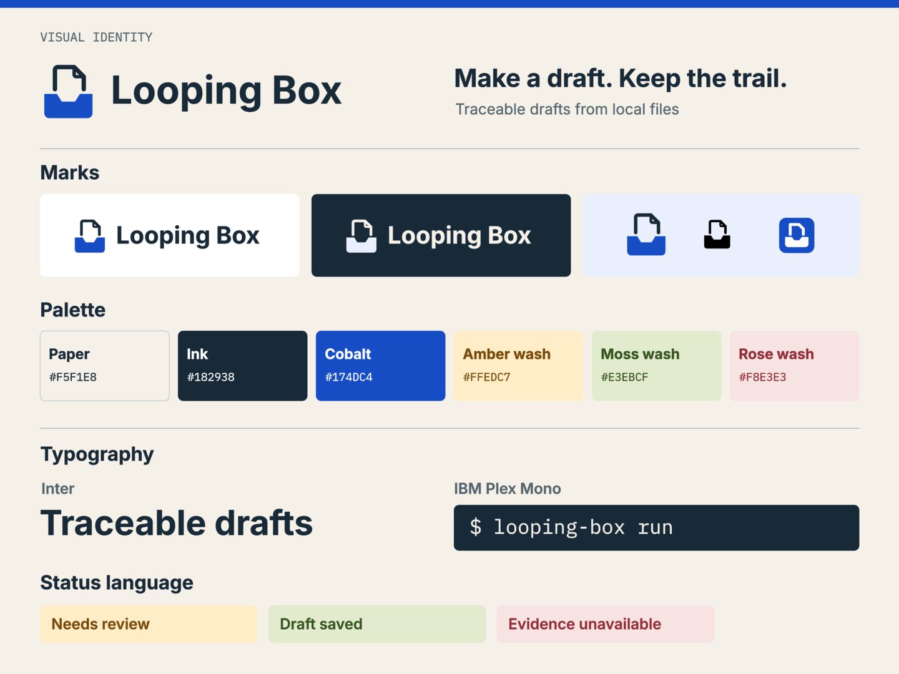

# Looping Box visual identity

**Make a draft. Keep the trail.**  
Traceable drafts from local files

## Art direction

Use the look of a well-organized paper workspace. A warm paper background supports long reading, ink gives the typography weight, and cobalt connects active steps and references. Show where a file entered, when it needed a person, and what draft came out. One paper stack or file path can carry the concept on its own.

The mark is a raised sheet with a folded corner above an open, notched file tray. Its simple shape works at a small size and connects the name to files. Keep the type beside the tray on a first encounter. The supplied lockups use outlined Inter lettering and work without installed fonts.

## Logo use

| Version | Surface | Minimum displayed width |
| --- | --- | --- |
| Primary horizontal | Paper or white | 144 px or 38 mm |
| Reversed horizontal | Ink | 144 px or 38 mm |
| Black horizontal | Single-color reproduction on a light surface | 144 px or 38 mm |
| Tray mark | Paper, white, or ink with the matching variant | 28 px or 8 mm |
| Simplified favicon | Its supplied cobalt tile | 16 px |
| App/avatar tile | Its supplied cobalt tile | 32 px |

- Leave clear space equal to one quarter of the mark artboard height on every side of a lockup or uncontained mark. That is 16 units at the source size or 8 px for a 32 px mark. Measure from the asset edge. The contained avatar and favicon can fill their assigned slots.
- Scale the provided artwork proportionally. Keep the fold, notch, and letter spacing intact. Use a paper or ink backing tile when a busy surface would compete with the mark.
- Pair the logo with the descriptor at the first mention in unfamiliar channels. Place the descriptor as live text outside the logo clear space so it can wrap.
- Use `Looping Box` as the alternative text for a standalone wordmark. Use empty alternative text when the mark sits beside the same visible name. For a logo link to the home page, use the accessible name `Looping Box home`.

## Color and contrast

The ratios below are for the specified foreground and background at full opacity. Aim for at least 4.5:1 for all reading text, including small text. Keep the meaning in the label and use color for reinforcement.

| Foreground | Background | Contrast | Use |
| --- | --- | --- | --- |
| Ink `#182938` | Paper `#F5F1E8` | 13.18:1 | Main reading surface |
| Paper `#F5F1E8` | Ink `#182938` | 13.18:1 | Reverse reading surface and terminal examples |
| Muted `#53646D` | Paper `#F5F1E8` | 5.46:1 | Captions and secondary information |
| Dark muted `#B8C6CC` | Ink `#182938` | 8.48:1 | Secondary information on ink |
| Cobalt `#174DC4` | Paper `#F5F1E8` | 6.43:1 | Underlined links and active details |
| White `#FFFFFF` | Cobalt `#174DC4` | 7.25:1 | Primary action or contained icon |
| Cobalt `#174DC4` | Blue wash `#E9EFFD` | 6.30:1 | Workflow and reference callouts |
| Amber `#774809` | Amber wash `#FFEDC7` | 6.70:1 | Needs review |
| Moss `#34551E` | Moss wash `#E3EBCF` | 6.92:1 | Draft saved |
| Rust `#922F38` | Rose wash `#F8E3E3` | 6.36:1 | Evidence unavailable |

Use white as a secondary light surface. Use blue wash for reference panels and illustrations. On ink, use Paper or Blue Wash for links with visible underlines. Keep status tones attached to their corresponding states. For an approval, write **Approved for drafting** and give the next action when it applies.

## Typography and layout

| Role | Family and weight | Suggested size and line height |
| --- | --- | --- |
| Display | Inter 700 | 52/56 px, 36/42 px on a narrow screen |
| Section heading | Inter 700 | 30/36 px, 26/32 px on a narrow screen |
| Lead | Inter 400 | 22/32 px |
| Body | Inter 400 | 18/28 px |
| Labels and controls | Inter 600 | 16/24 px |
| Captions | Inter 400 | 16/24 px |
| Commands, paths, literal status | IBM Plex Mono 400 | 16/24 px |

Use a system sans fallback and a system monospace fallback. The [CSS tokens](assets/tokens.css) provide both stacks and a 4 px spacing base. Use 8–16 px between closely related items, 24–32 px between content groups, and 48–64 px between major sections. Set prose in a left-aligned column of roughly 55–70 characters. Keep content in normal document flow so it can reflow when text is enlarged. Let long code examples scroll inside their container and put the next action in adjacent readable text.

Use underlined links, visible focus indicators and text labels on controls. Target at least 44 × 44 CSS px for primary controls. Reserve uppercase mono for brief publication captions. Keep the product name in title case and use sentence case for content and controls.

## Images and terminal material

- Use the file stack as a decorative illustration for social or cover material. Orthogonal lines and printed-paper proportions carry through from the mark. Use one clear subject and ample room around it.
- Show the real CLI and ordinary files in demos. Use a disposable fixture workspace and a high-contrast terminal. Crop to the relevant command, outcome, and path. Put exact commands in selectable text and transcribe the meaningful output. Use an **Illustrative example** label for constructed output.
- In an optional OpenRouter demo, show the source path, the returned model, and the saved draft. If you include a cost, label it as the provider's reported cost for that run. The offline sample can show the original excerpt beside the source path. [Recorded examples](collateral/openrouter-example-transcript.md)
- Use **Needs review** as the label on a hold. Show the approval or rejection as a person’s decision. Put **Run again** on the path to a local draft after approval. Caption the saved artifact and include an example source reference.
- The static graphics use outlined text. Give social cards alternative text and include the workflow in nearby HTML or Markdown. Use the workflow description below when the graphic is unavailable.

### Workflow text equivalent

`looping-box run` reads supported Markdown, text and JSON files from the local inbox. Eligible work can produce a local draft with source references. When a configured review term matches, the item is held for a person to review. If the person approves the item for drafting, run again. A rejection keeps the item out of drafting.

### Social card text alternative

“Looping Box. Make a draft. Keep the trail. Traceable drafts from local files. Offline by default.” The file-stack illustration is decorative.

## Asset index

| Asset | Use |
| --- | --- |
| [Primary lockup](assets/looping-box-lockup.svg), [reverse lockup](assets/looping-box-lockup-reverse.svg), [black lockup](assets/looping-box-lockup-mono.svg) | Standard transparent vector wordmarks |
| [Primary lockup PNG](assets/looping-box-lockup.png) | 640 × 128 transparent fallback for documents or tools that need a raster |
| [Tray mark](assets/looping-box-mark.svg), [reverse mark](assets/looping-box-mark-reverse.svg), [black mark](assets/looping-box-mark-mono.svg) | Standalone marks when the name is established |
| [Avatar tile SVG](assets/app-icon.svg), [avatar tile PNG](assets/app-icon.png) | Cobalt tile, including a 512 × 512 export for profile or repository artwork |
| [Favicon SVG](assets/favicon.svg), [32 px PNG](assets/favicon.png), [multi-size ICO](assets/favicon.ico) | Simplified mark for small browser or shortcut surfaces, with 16, 32 and 48 px ICO layers |
| [Wide social card PNG](assets/social-wide.png), [wide source SVG](assets/social-wide.svg) | 1200 × 630 preview art |
| [Square social card PNG](assets/social-square.png), [square source SVG](assets/social-square.svg) | 1080 × 1080 feed or square share art |
| [Workflow diagram SVG](assets/workflow.svg), [workflow diagram PNG](assets/workflow.png) | 1200 × 530 overview of a normal run and review branch |
| [Identity board PNG](assets/brand-board.png), [identity board source SVG](assets/brand-board.svg) | 1440 × 1080 visual reference |
| [CSS tokens](assets/tokens.css) | Shared color, type stack, spacing, and radius values |

Keep the vector originals when preparing another size. SVG artwork has no external resource references. Text in the provided art is outlined for consistent rendering. To change copy, retype the new text in Inter or IBM Plex Mono, outline it in the production copy, then regenerate the raster at its intended dimensions. Put complete text and appropriate alternative text alongside every published graphic.
